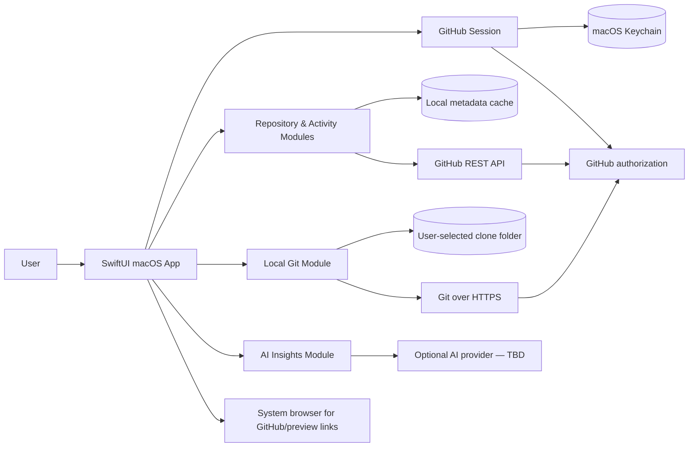

# dev — Architectural Requirements Document

**Status:** Proposed architecture for the v1 product brief  
**Platform:** Native macOS, Swift, SwiftUI; target the latest macOS release at implementation time  
**Primary constraint:** A single-user desktop app with narrowly scoped pull-request writes and user-directed local clones.

## 1. Context and system shape

The macOS app owns presentation, local project bookmarks and directory listing, local clone orchestration, caching, and polling. GitHub remains the source of truth for remote records. No app backend or webhook receiver is required for the chosen v1 flow. If a future AI provider requires a server-side secret or proxy, that is a separate architecture/security decision.

## 2. Modules and interfaces

| Module | Responsibility | Interface expectation |
|---|---|---|
| App shell and navigation | Native workspace shell, welcome Overview, cross-project views, project workspace destinations, global themes, and the tabbed right-side tool panel | Views bind to view models; no network/Git work on the main actor. Overview remains usable without GitHub sign-in and provides New/Open/Clone, recents, a searchable picker, and recent PRs. The tool panel has a persistent draggable width, clamps to available window space while retaining 320 points for workspace content, and switches to full content width when side-by-side layout no longer fits. It retains independent Browser/Terminal/Codex tabs and three recent-project shortcuts; Codex starts the installed `codex` CLI in the selected local project. GitHub repositories and explicit local folders remain separate entries. |
| GitHub session | Device authorization, installed-account discovery, token refresh/revocation handling | Exposes current account, granted repository access, and an authenticated request capability; token values never leave the session module. |
| GitHub API adapter | REST reads for repositories, bounded recent PR summaries across accessible repositories, project history, PR files/comments/reviews and open-PR counts; explicit PR create/comment/review/merge operations; GraphQL contribution calendar and category totals | Typed results, pagination, cancellation, conditional requests, and structured auth/rate-limit/network failures. Only the listed PR actions write. Contribution queries use the signed-in viewer; private/internal contribution data depends on GitHub's optional `read:user` scope. |
| Repository catalog and activity | Merge fetched records into project summaries and recent feed | Source-linked records with fetched-at/stale state; deterministic mapping only. |
| Quick Summary | Compact PR summary, common tool shortcuts, animated activity, notch panel, and menu bar fallback | One shared WorkspaceStore drives both surfaces. Detect camera-housing displays from `NSScreen.safeAreaInsets` and `auxiliaryTopLeftArea`/`auxiliaryTopRightArea`; center the collapsed panel at the top screen edge with physical-notch side wings, then expand downward with the notch anchored. Retarget geometry when displays change. All displays retain a SwiftUI `MenuBarExtra`. Poll every 60 seconds by default while the app runs, configurable to 300 or 900 seconds, with at least five-minute backoff after partial/API failures. System notifications remain disabled until explicitly enabled in Settings and OS permission is granted. |
| Skills library | Search, scan, import, catalog, and offline preview of skills | Authenticated GitHub code search runs only on user action; selected source reads use existing Contents read access. Each import is capped at 100 files, 2 MB per file, and 10 MB total. Imported files remain local and install commands are inert text. |
| Local Git and file access | Clone, fetch, branch/commit graph, current branch, working-tree/worktree status, terminal session starting directory, selected-file preview, and explicit skill scanning | Git history reads only metadata. The local file viewer reads a user-selected text file from the bookmarked project folder into memory for read-only display, enforces folder containment, rejects symlinks and files over 2 MB, and does not persist or transmit those previews. The separate Skills library may copy regular files from discovered/selected skill folders to Application Support for offline preview; it skips hidden paths and symlinks. Terminal commands are explicitly user-launched and run with the app user's normal macOS permissions; project cwd is not a filesystem restriction. |
| Embedded browser and terminal | User-launched HTTP(S) browser tabs and interactive local shell tabs | Browser uses WKWebView without a native JavaScript bridge; shell uses SwiftTerm's macOS PTY host. Keep each tab's view/session alive while switching tabs and close child processes when their tabs close. Child shell hooks report command labels and exit status through a private temporary file, without changing user startup files or capturing output. |
| Appearance | Persisted workspace-content background theme, per-theme color palettes, and reduced-motion-aware animation | Theme selection is single-select, applies across workspace pages below the app header, and each theme saves its own Aqua, Violet, Amber, or Emerald palette. Content surfaces keep readable contrast. |
| Cache/preferences | Persist small app state, fetched metadata, and the Skills library | Store accessible repository inventory, clone paths, recent-project order, refresh metadata, preferences, skill catalog records and offline skill copies; tokens only in Keychain. Cache can be cleared without deleting clones. |
| Poller and notifications | Detect new/changed PRs across accessible repositories | Runs only while app is active and compares the eight most recently updated PRs per repository; the overview displays eight total. Configurable interval, deduplicated notifications, and backoff on failures/rate limits. |
| AI insight adapter | Optional grounded summaries and explanations | Provider-neutral interface; explicit selected-project input; returns explanation plus source IDs/URLs. Disabled until provider and consent are chosen. |
| Preview/link opener | Open GitHub and deployment preview destinations | Validate HTTPS URLs and require user action; GitHub-record preview links continue to use the system browser. The separate Browser tool may load user-entered HTTP(S) URLs in an isolated WKWebView. |

Prefer Apple frameworks (`SwiftUI`, `WebKit`, `URLSession`, `Security`/Keychain, `UserNotifications`, `FileManager`, and `Process`) and system Git. SwiftTerm 1.20.0 is the one new dependency because an interactive terminal needs a real PTY and VT100/Xterm renderer. Confirm Git availability at runtime. Keep external GitHub API types behind the adapter so UI models do not depend on transport details.

## 3. Authentication and authorization

- Register a **GitHub App** with Device Flow enabled. GitHub documents Device Flow as suitable for desktop applications. Use the native UI to show the user code, open GitHub’s verification page, and poll only at the interval GitHub returns.
- Use a GitHub App user access token for API access. The app must be installed/enabled on the personal account and each organization whose repositories should appear. Access is the intersection of the user’s access, the app’s permissions, and the installation’s repository scope; organization policy/SSO can require additional approval.
- Request read permissions for repository metadata, contents (for HTTP Git clone/fetch), issues, checks, commit statuses, and deployments as needed. Pull requests permission must be write for PR creation, comment/review, and merge actions. No other write permission is needed; the app does not push local branches.
- Store access/refresh tokens in Keychain. Handle expiry, refresh where available, revocation, denied access, and reauthorization without logging credentials. If a token cannot be refreshed, explain the sign-in recovery path.
- Do not place credentials in clone URLs, command-line arguments, shell command strings, Git remotes, crash reports, or logs. Provide an ephemeral Git credential mechanism and redact child-process output. Never persist an authenticated remote URL.

GitHub documents fine-grained GitHub App permissions, user/device authorization, and use of access tokens for HTTP Git operations. Device-flow and token behavior can change; verify app registration settings and permissions during implementation. Sources: [GitHub App user access tokens and Device Flow](https://docs.github.com/en/apps/creating-github-apps/authenticating-with-a-github-app/generating-a-user-access-token-for-a-github-app), [GitHub App permissions for API and Git access](https://docs.github.com/en/apps/creating-github-apps/registering-a-github-app/choosing-permissions-for-a-github-app), [GitHub App user access restrictions](https://docs.github.com/en/apps/creating-github-apps/authenticating-with-a-github-app/authenticating-with-a-github-app-on-behalf-of-a-user).

## 4. GitHub data and synchronization

- Use GitHub REST endpoints for repository discovery and v1 records. Pin the supported API version in one client configuration and update it deliberately.
- Paginate list endpoints and retain stable repository IDs. Do not infer that an absent item was deleted until access and pagination are confirmed.
- Fetch the minimum fields and pages needed for the selected views. Cache ETags/last-modified values and use conditional requests. Respect primary and secondary rate-limit headers; pause and retry with bounded backoff rather than polling through a rate limit.
- Refresh compact PR summaries across all accessible repositories on launch/foreground and then on a configurable interval while running (starting default: five minutes). Fetch full PR discussions and changed-file lists on demand. Use conditional requests, batch work, and surface per-repository stale state if rate limits or repository count delay a refresh.
- Use PR and issue update timestamps and commit/branch metadata to build a chronological feed. Deduplicate items by GitHub ID plus event/update time.
- Branch graph layout is computed locally from Git commit parents and refs, then enriched with source-linked PR/merge records. It must not claim deleted refs or missing history are present.

Primary guidance: [GitHub REST API best practices](https://docs.github.com/en/rest/using-the-rest-api/best-practices-for-using-the-rest-api) and [REST API rate limits](https://docs.github.com/en/rest/using-the-rest-api/rate-limits-for-the-rest-api). Repository access is installation-scoped; see [GitHub App installation repository endpoints](https://docs.github.com/en/rest/apps/installations).

## 5. Local clone and worktree behavior

- Clone only after the user selects a repository and confirms the destination. Use the chosen parent folder plus the repository name. Refuse to overwrite a non-empty destination; surface collisions and partial failures without silently deleting files.
- Run Git as an argument-vector process (never interpolate user/repository strings into a shell command). Keep cancellation and progress visible. Check process exit status and present actionable errors.
- Clone/fetch use read-only GitHub Contents access. Fetch updates remote-tracking refs; it does not push. The local working tree remains under the user’s control.
- Report the local path, current branch, clean/modified state, ahead/behind data when known, local and remote refs, commit graph, and linked worktrees discoverable through Git. Label unavailable local state rather than substituting remote data.
- Do not scan source files for AI, run builds from the file viewer, delete clones, or alter local branches in v1. The Skills library is a narrow exception: it scans cloned repositories for `SKILL.md` and advertised skill links after cloning or on explicit refresh, plus folders and GitHub URLs the user selects. It copies regular files from imported skill folders into local app storage for offline preview, skips hidden paths and symlinks, caps copies at 100 files/2 MB per file/10 MB total, and never sends their contents to AI or executes their commands.

## 6. Data, privacy, and AI

- Persist only what is needed for project selection, clone association, refresh state, user settings, an offline/stale metadata view, and the user-selected Skills library. Keep skill metadata and file copies in Application Support; refresh preserves category edits and a missing source does not delete the offline copy. Remove cached GitHub metadata on sign-out when the user chooses to clear local data. Never remove local clones or library files as a side effect of sign-out.
- Offline skill previews render UTF-8 text up to the existing 2 MB preview limit. Other regular files within the import size limits are kept in the offline copy and shown as unavailable for preview.
- Local repositories reside in the user-selected directory and follow normal macOS filesystem protection. The app must disclose that cloned repository files remain there after sign-out.
- No AI provider is selected. The AI module is disabled until a provider, transmission scope, retention behavior, and explicit consent are defined. Never include secrets, credentials, or local file contents in prompts. Ordinary Local Projects previews are not persisted or transmitted. User-imported Skills are the explicit exception: their regular files are stored locally for offline preview, never synced or sent to AI. Submitted online skill-search queries go to GitHub only when the user invokes GitHub search.
- Theme preference is local app state, stored separately from GitHub metadata and Keychain credentials. Animated backgrounds are decorative and do not collect or transmit data.
- Browser tabs only navigate HTTP(S) URLs; do not expose app data/actions through JavaScript message handlers. GitHub preview links remain explicit user actions in the system browser.
- Terminal commands inherit the macOS account permissions of the app. A selected project controls initial cwd only; present this distinction in the terminal launcher. Do not claim the terminal is sandboxed or project-confined.
- Command activity is processed locally and displays only the executable label and exit state; temporary event files never contain command arguments or shell output. Shell hooks are installed only in the child shell's temporary startup context, and the temporary files are removed when the terminal closes.
- Treat model output as untrusted. Validate its shape, label it as generated, and require cited fetched records for project-specific claims. Render the deterministic graph and status counts even when AI is unavailable.
- Do not add telemetry by default. If telemetry is later proposed, document the fields, retention, destination, and opt-in before implementation.

## 7. Reliability, accessibility, and security requirements

- All network and Git work is asynchronous, cancellable, and isolated from the UI thread. Present loading, empty, stale, offline, permission, rate-limit, and partial-data states separately.
- No automatic retry loop without a bound. Use server retry guidance, bounded backoff, and a visible manual refresh.
- Use SwiftUI controls with keyboard support, VoiceOver labels, contrast-aware system appearances, and non-color status cues. The global animated theme is decorative, remains low contrast behind content, and pauses under Reduce Motion.
- Open preview URLs only on user action. The dedicated browser tool accepts only HTTP(S), has no app bridge, and does not grant local-file access. GitHub-recorded preview links continue to open externally.
- Unit-test pure graph/feed mapping and permission/error mapping. Test adapters through deterministic fake HTTP/Git processes; include integration smoke checks against a test repository/account before release. Keep the write surface to PR creation, PR issue comments, PR reviews, and PR merge; Git push and all other GitHub mutation paths remain unavailable.

## 8. Architecture decisions and tradeoffs

| Decision | Choice | Reason / cost |
|---|---|---|
| Native UI | SwiftUI macOS app | Matches the user’s platform and provides native accessibility and notifications. |
| GitHub auth | GitHub App Device Flow + user access token | Native desktop flow and fine-grained permissions; PR create/comment/review/merge require Pull requests: write permission on the app and account/org installation. |
| GitHub sync | Direct REST reads with polling | No backend/webhook service; slower than webhooks and constrained by rate limits. |
| Interactive terminal | SwiftTerm 1.20.0 AppKit terminal and local PTY host | Provides actual shell and terminal emulation; commands retain normal user permissions. MIT license. |
| In-app browser | WebKit `WKWebView` in tool tabs | Enables user-requested embedded browsing without exposing app APIs to page JavaScript. |
| Local Git | System Git through a narrow process adapter | Avoids a Git library dependency; requires runtime availability checks and careful credential handoff. |
| Local persistence | Keychain for credentials; small local metadata store for app state/cache | Separate secrets from ordinary cache; implementation can choose SwiftData or a small file-backed store after modeling the cache. |
| AI | Provider-neutral module, gated until chosen | Preserves user’s undecided provider choice; AI is not release-ready until privacy/consent is settled. |
| Preview | System browser, user-initiated | Avoids embedded arbitrary content and build/hosting infrastructure. |

## 9. Open implementation decisions

- Exact GitHub App registration owner, installation configuration, endpoint permission set, and organization approval/SSO experience.
- AI provider/model, private-data policy, consent UI, retention, cost, latency, and evaluation targets.
- Cache persistence choice and offline retention period.
- Polling default/maximum and macOS notification defaults after rate-limit testing with representative repository counts.
- How to handle already-existing local clones in a later version; v1 creates clones from the app.
- Graph scale limits for large repositories.

## 10. Navigation and visual direction

- Use a persistent, collapsible macOS sidebar and a focused detail area, following the familiar workspace hierarchy described in the product requirements. Use `dev` branding and GitHub-specific labels and content.
- Global destinations are **All Projects** and **Activity**. The **Projects** section lists repositories; **Settings** remains available from the app shell.
- Selecting a repository opens **Overview**, **Branches**, **Commits**, **Pull Requests**, or **Issues**. Keep contributors and project activity available from the overview/activity context rather than adding more top-level navigation.
- The branch/commit graph is the primary project visualization. Show source-linked records and explicit remote/local labels instead of generic analytics charts. Large branch and commit collections stay in the selected project view, not the global sidebar.
- This is a presentation decision only; it does not change the bounded PR write actions or local clone behavior.
