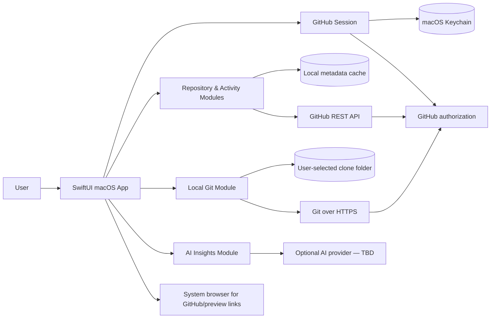

# dev — Architectural Requirements Document

**Status:** Proposed architecture for the v1 product brief  
**Platform:** Native macOS, Swift, SwiftUI; target the latest macOS release at implementation time  
**Primary constraint:** A single-user desktop app with read-only GitHub access and user-directed local clones.

## 1. Context and system shape

The macOS app owns presentation, local clone orchestration, caching, and polling. GitHub remains the source of truth for remote records. No app backend or webhook receiver is required for the chosen v1 flow. If a future AI provider requires a server-side secret or proxy, that is a separate architecture/security decision.

## 2. Modules and interfaces

| Module | Responsibility | Interface expectation |
|---|---|---|
| App shell and navigation | Native workspace shell with collapsible sidebar, cross-project views, project workspace destinations, and settings | Views bind to view models; no network/Git work on the main actor. One GitHub repository is one project; v1 has no extra folder/group layer. |
| GitHub session | Device authorization, installed-account discovery, token refresh/revocation handling | Exposes current account, granted repository access, and an authenticated request capability; token values never leave the session module. |
| GitHub REST adapter | Repository, branch/commit, PR/review/comment, issue, contributor, check/status, and deployment reads | Typed results, pagination, cancellation, conditional requests, and structured auth/rate-limit/network failures. |
| Repository catalog and activity | Merge fetched records into project summaries and recent feed | Source-linked records with fetched-at/stale state; deterministic mapping only. |
| Local Git adapter | Clone, fetch, branch/commit graph, current branch, working-tree and worktree status | Takes a repository identity and user-selected destination; returns progress/status/errors. It performs no push or write to GitHub. |
| Cache/preferences | Persist small app state and fetched metadata | Store accessible repository inventory, clone paths, refresh metadata and preferences; tokens only in Keychain. Cache can be cleared without deleting clones. |
| Poller and notifications | Detect new/changed PRs across accessible repositories | Runs only while app is active, configurable interval, deduplicates notifications, suspends/backoffs on rate limits. |
| AI insight adapter | Optional grounded summaries and explanations | Provider-neutral interface; explicit selected-project input; returns explanation plus source IDs/URLs. Disabled until provider and consent are chosen. |
| Preview/link opener | Open GitHub and preview destinations | Validate HTTP(S) URLs, require user action, delegate to system browser. |

Prefer Apple frameworks (`SwiftUI`, `URLSession`, `Security`/Keychain, `UserNotifications`, `FileManager`, and `Process`) and the system Git executable before adding dependencies. Confirm availability of Git at runtime and explain how to install the required developer tools if missing. Keep external GitHub API types behind the adapter so UI models do not depend on transport details.

## 3. Authentication and authorization

- Register a **GitHub App** with Device Flow enabled. GitHub documents Device Flow as suitable for desktop applications. Use the native UI to show the user code, open GitHub’s verification page, and poll only at the interval GitHub returns.
- Use a GitHub App user access token for API access. The app must be installed/enabled on the personal account and each organization whose repositories should appear. Access is the intersection of the user’s access, the app’s permissions, and the installation’s repository scope; organization policy/SSO can require additional approval.
- Request only read permissions: repository metadata, contents (for HTTP Git clone/fetch), pull requests, issues, checks, commit statuses, and deployments as needed by the selected endpoints. Do not request write permissions in v1.
- Store access/refresh tokens in Keychain. Handle expiry, refresh where available, revocation, denied access, and reauthorization without logging credentials. If a token cannot be refreshed, explain the sign-in recovery path.
- Do not place credentials in clone URLs, command-line arguments, shell command strings, Git remotes, crash reports, or logs. Provide an ephemeral Git credential mechanism and redact child-process output. Never persist an authenticated remote URL.

GitHub documents fine-grained GitHub App permissions, user/device authorization, and use of access tokens for HTTP Git operations. Device-flow and token behavior can change; verify app registration settings and permissions during implementation. Sources: [GitHub App user access tokens and Device Flow](https://docs.github.com/en/apps/creating-github-apps/authenticating-with-a-github-app/generating-a-user-access-token-for-a-github-app), [GitHub App permissions for API and Git access](https://docs.github.com/en/apps/creating-github-apps/registering-a-github-app/choosing-permissions-for-a-github-app), [GitHub App user access restrictions](https://docs.github.com/en/apps/creating-github-apps/authenticating-with-a-github-app/authenticating-with-a-github-app-on-behalf-of-a-user).

## 4. GitHub data and synchronization

- Use GitHub REST endpoints for repository discovery and v1 records. Pin the supported API version in one client configuration and update it deliberately.
- Paginate list endpoints and retain stable repository IDs. Do not infer that an absent item was deleted until access and pagination are confirmed.
- Fetch the minimum fields and pages needed for the selected views. Cache ETags/last-modified values and use conditional requests. Respect primary and secondary rate-limit headers; pause and retry with bounded backoff rather than polling through a rate limit.
- Refresh compact PR summaries across all accessible repositories on launch/foreground and then on a configurable interval while running (starting default: five minutes). Fetch full PR discussions and changed-file lists on demand. Use conditional requests, batch work, and surface per-repository stale state if rate limits or repository count delay a refresh.
- Use PR and issue update timestamps and commit/branch metadata to build a chronological feed. Deduplicate items by GitHub ID plus event/update time.
- Branch graph layout is computed locally from Git commit parents and refs, then enriched with source-linked PR/merge records. It must not claim deleted refs or missing history are present.

Primary guidance: [GitHub REST API best practices](https://docs.github.com/en/rest/using-the-rest-api/best-practices-for-using-the-rest-api) and [REST API rate limits](https://docs.github.com/en/rest/using-the-rest-api/rate-limits-for-the-rest-api). Repository access is installation-scoped; see [GitHub App installation repository endpoints](https://docs.github.com/en/rest/apps/installations).

## 5. Local clone and worktree behavior

- Clone only after the user selects a repository and confirms the destination. Use the chosen parent folder plus the repository name. Refuse to overwrite a non-empty destination; surface collisions and partial failures without silently deleting files.
- Run Git as an argument-vector process (never interpolate user/repository strings into a shell command). Keep cancellation and progress visible. Check process exit status and present actionable errors.
- Clone/fetch use read-only GitHub Contents access. Fetch updates remote-tracking refs; it does not push. The local working tree remains under the user’s control.
- Report the local path, current branch, clean/modified state, ahead/behind data when known, local and remote refs, commit graph, and linked worktrees discoverable through Git. Label unavailable local state rather than substituting remote data.
- Do not scan source files for AI, index source contents, run builds, delete clones, or alter local branches in v1.

## 6. Data, privacy, and AI

- Persist only what is needed for project selection, clone association, refresh state, user settings, and an offline/stale metadata view. Use stable GitHub IDs; remove cached GitHub metadata on sign-out when the user chooses to clear local data. Never remove local clones as a side effect of sign-out.
- Local repositories reside in the user-selected directory and follow normal macOS filesystem protection. The app must disclose that cloned repository files remain there after sign-out.
- No AI provider is selected. The AI module is disabled until a provider, transmission scope, retention behavior, and explicit consent are defined. Never include secrets, credentials, or local file contents in prompts.
- Treat model output as untrusted. Validate its shape, label it as generated, and require cited fetched records for project-specific claims. Render the deterministic graph and status counts even when AI is unavailable.
- Do not add telemetry by default. If telemetry is later proposed, document the fields, retention, destination, and opt-in before implementation.

## 7. Reliability, accessibility, and security requirements

- All network and Git work is asynchronous, cancellable, and isolated from the UI thread. Present loading, empty, stale, offline, permission, rate-limit, and partial-data states separately.
- No automatic retry loop without a bound. Use server retry guidance, bounded backoff, and a visible manual refresh.
- Use SwiftUI controls with keyboard support, VoiceOver labels, contrast-aware system appearances, and non-color status cues.
- Open preview URLs only on user action and only for HTTP(S). Do not load arbitrary preview content in an embedded privileged web view.
- Unit-test pure graph/feed mapping and permission/error mapping. Test adapters through their interfaces with deterministic fake HTTP/Git processes; include integration smoke checks against a test repository/account before release. Verify no write endpoints or Git push paths are reachable in the app.

## 8. Architecture decisions and tradeoffs

| Decision | Choice | Reason / cost |
|---|---|---|
| Native UI | SwiftUI macOS app | Matches the user’s platform and provides native accessibility and notifications. |
| GitHub auth | GitHub App Device Flow + user access token | Native desktop flow and fine-grained permissions; requires app registration and account/org installation. |
| GitHub sync | Direct REST reads with polling | No backend/webhook service; slower than webhooks and constrained by rate limits. |
| Local Git | System Git through a narrow process adapter | Avoids a Git library dependency; requires runtime availability checks and careful credential handoff. |
| Local persistence | Keychain for credentials; small local metadata store for app state/cache | Separate secrets from ordinary cache; implementation can choose SwiftData or a small file-backed store after modeling the cache. |
| AI | Provider-neutral module, gated until chosen | Preserves user’s undecided provider choice; AI is not release-ready until privacy/consent is settled. |
| Preview | System browser, user-initiated | Avoids embedded arbitrary content and build/hosting infrastructure. |

## 9. Open implementation decisions

- Exact GitHub App registration owner, installation configuration, endpoint permission set, and organization approval/SSO experience.
- AI provider/model, private-data policy, consent UI, retention, cost, latency, and evaluation targets.
- Cache persistence choice and offline retention period.
- Polling default/maximum and macOS notification defaults after rate-limit testing with representative repository counts.
- How to handle already-existing local clones in a later version; v1 creates clones from the app.
- Graph scale limits for large repositories.

## 10. Navigation and visual direction

- Use a persistent, collapsible macOS sidebar and a focused detail area, following the familiar workspace hierarchy described in the product requirements. Use `dev` branding and GitHub-specific labels and content.
- Global destinations are **All Projects** and **Activity**. The **Projects** section lists repositories; **Settings** remains available from the app shell.
- Selecting a repository opens **Overview**, **Branches**, **Commits**, **Pull Requests**, or **Issues**. Keep contributors and project activity available from the overview/activity context rather than adding more top-level navigation.
- The branch/commit graph is the primary project visualization. Show source-linked records and explicit remote/local labels instead of generic analytics charts. Large branch and commit collections stay in the selected project view, not the global sidebar.
- This is a presentation decision only; it does not change GitHub access, local clone behavior, or the read-only v1 contract.
