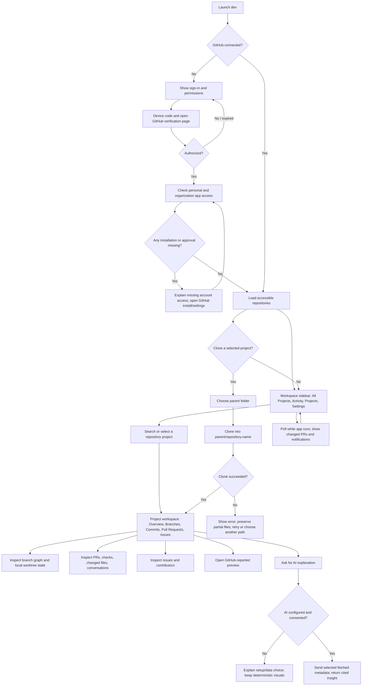

# dev — End-to-End User Flow

## Flow at a glance

## Detailed screens and actions

### 1. First launch and GitHub sign-in

- Explain the app reads GitHub project data and can clone selected repositories locally. State that v1 does not write to GitHub.
- Start GitHub App Device Flow. Show the verification code, expiration, and a button to open GitHub’s verification page in the default browser.
- Poll at GitHub’s instructed interval. Show pending, denied, expired, network-error, and success states distinctly.
- Save tokens in Keychain. If access expires or is revoked, pause synchronization and offer sign-in again.

### 2. Account and organization access

- After authorization, load the user profile and the installations/repositories accessible to the app.
- Show personal repositories and repositories from organizations where the app is installed and approved.
- If an expected organization is missing, explain that organization installation, SSO, or admin approval may be required and link to GitHub’s relevant settings. Never imply sign-in alone grants access to every repository.
- Allow refresh of repository discovery.

### 3. Projects dashboard

- Use a collapsible workspace sidebar with **All Projects**, **Activity**, a **Projects** section containing one row per GitHub repository, and **Settings**. There is no separate folder layer in v1.
- Selecting a repository opens its project workspace. Keep long branch and commit lists inside that workspace so the sidebar remains scannable.
- Show project cards/list rows with owner/repository, visibility, default branch, last push, clone state, and recent activity.
- Provide search and owner/activity filters. Distinguish loading, no accessible repositories, partial permission, and network failure.
- Recent items combine PR updates, commits, issue changes, reviews, and merges across accessible repositories; each item opens its GitHub source.
- Show a last-synced timestamp and manual refresh.

### 4. Clone a project

1. User selects **Clone** on one or more repositories.
2. On first clone, request a parent folder with a native folder picker; remember the selected parent as a preference.
3. Create `<parent>/<repository-name>`. Confirm the destination and never overwrite an existing non-empty path.
4. Obtain a short-lived credential through the Git credential adapter; never embed it in the URL or save it to the remote config.
5. Run clone with progress and cancellation. On failure, show Git’s sanitized error and leave partial files untouched for user review.
6. On success, associate the path with the GitHub repository and load local refs/worktree state.

### 5. Project workspace — Main Work

- Provide **Overview**, **Branches**, **Commits**, **Pull Requests**, and **Issues** destinations within the selected project.
- **Project pulse:** open PRs, reviews waiting, checks failing/passing, open issues, recent merges, latest commits, and contributor activity.
- **Branch graph:** the main project visualization; show the default branch, remote/local branches, commits, merge relationships, and related PRs when GitHub provides them. Use source-linked GitHub records and clear remote/local labels instead of generic analytics charts.
- **Local checkout card:** linked/unlinked clone state, path, current branch, clean/modified state, ahead/behind status, and any linked Git worktrees detected.
- **Activity timeline:** recent changes with source links and timestamps.
- Distinguish GitHub’s last update from the local clone’s last fetch. If local fetch fails, preserve and label the last known local state.

### 6. Pull requests, issues, commits, and contributors

- Selecting a PR opens its state, title, author, reviewers, labels, checks, changed files, description, discussion/comments, and merge time.
- Selecting an issue shows state, labels, assignee, author, and activity.
- Selecting a contributor shows available profile and repository activity links; do not claim all contribution history if API access is incomplete.
- Selecting a commit opens its details and GitHub page; local graph selection may also focus the commit in the branch graph.
- Every summary or count links to the source records from which it was derived.

### 7. Preview links

- Display preview/deployment links reported by a GitHub check or deployment status, including the source check and timestamp.
- Require an explicit click and open the URL in the system browser. Do not automatically fetch or embed the preview.

### 8. AI project explanation

- User opens an AI insight from the project pulse or asks a question about fetched project metadata/activity.
- If provider setup or consent is absent, keep the deterministic dashboard available and explain that AI requires a provider/data choice.
- When enabled, send only the selected project data necessary for the request. Never send local source files or tokens.
- Display a short generated explanation with evidence links. Mark unsupported or unavailable data as unknown; do not infer missing branches, authors, or status.

### 9. Polling, notifications, and recovery

- Refresh compact PR summaries across all accessible repositories at launch/foreground and then at the configured interval while the app is active. Load full PR conversations and changed-file lists when opened. Show per-repository stale state when rate limits delay work.
- Ask permission before macOS notifications; let the user disable notifications separately from in-app activity.
- Respect GitHub rate limits and network retry guidance. During throttling, show when another refresh can occur.
- On sign-out, revoke/clear stored app credentials and optionally clear cached GitHub metadata. Never delete clone folders. Make clear that local clones persist until the user removes them in Finder.

## Important edge cases

| Condition | User-visible behavior |
|---|---|
| Organization app not installed or awaiting approval | Explain which account is missing and provide a GitHub settings link. |
| Repository removed from installation or access revoked | Mark access unavailable; do not delete local clone or cached history automatically. |
| Destination exists | Refuse overwrite; offer choose another folder. |
| Git unavailable | Explain required developer tools and keep remote GitHub views usable. |
| Clone interrupted or disk full | Show sanitized process error, retain partial data, offer retry after user review. |
| Branch deleted after merge | Keep the PR/merge record if GitHub returns it; label branch ref as deleted/unavailable. |
| API rate limit/offline | Preserve last known data, mark it stale, and show next refresh/retry. |
| AI unavailable or disabled | Continue deterministic views; do not fabricate an AI summary. |
| Preview URL invalid or unsupported scheme | Disable the link and explain that only web URLs can be opened. |
