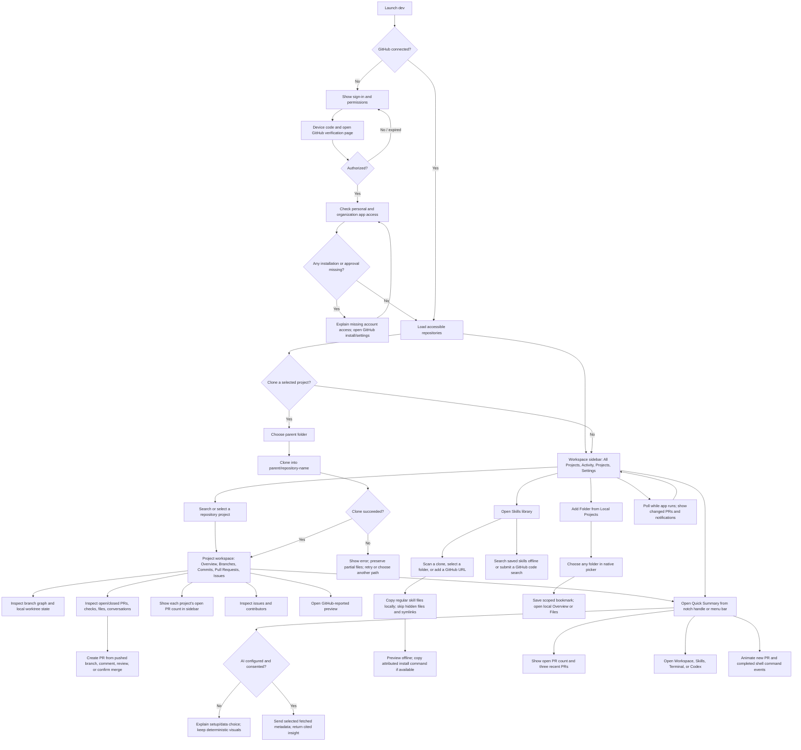

# dev — End-to-End User Flow

## Flow at a glance

## Detailed screens and actions

### 1. First launch and GitHub sign-in

- Explain that GitHub project data is read and selected repositories can be cloned locally. PR creation, comments, submitted reviews, and confirmed merges are the only GitHub write actions. A new PR uses branches already pushed to GitHub; the app never pushes local branches.
- Start GitHub App Device Flow. Show the verification code, expiration, and a button to open GitHub’s verification page in the default browser.
- Poll at GitHub’s instructed interval. Show pending, denied, expired, network-error, and success states distinctly.
- Save tokens in Keychain. If access expires or is revoked, pause synchronization and offer sign-in again.

### 2. Account and organization access

- After authorization, load the user profile and the installations/repositories accessible to the app.
- Show the authenticated GitHub login in the sidebar using the read-only GraphQL `viewer { login }` field.
- Show personal repositories and repositories from organizations where the app is installed and approved.
- If an expected organization is missing, explain that organization installation, SSO, or admin approval may be required and link to GitHub’s relevant settings. Never imply sign-in alone grants access to every repository.
- Allow refresh of repository discovery.

### 3. Welcome Overview

- Keep the Overview available whether or not GitHub is connected. Show **New project**, **Open project**, and **Clone project** actions. New project validates a name and creates an empty child folder inside a user-selected parent; Open project bookmarks a user-selected folder; Clone project lists accessible GitHub repositories and reuses the protected clone flow.
- Show recent projects and at least five recently updated PRs with project identity and status. Show **More** for PRs only when more than five are available; open the full recent-PR list. Project **More** opens a searchable recent-project picker.
- The right Overview panel configures a single global background theme instead of showing a commits heatmap. Apply it below the app header, behind workspace content. Pixel Mosaic fills the workspace with a large, drifting pixel field; Terminal Stream renders a flowing ASCII luminance field in its selected palette; Aurora Wave is one continuous pixelated wave rising from the bottom toward the top, with subtle flowing glow and sparse sparkles in its selected palette. Each theme saves its own Aqua, Violet, Amber, or Emerald color choice. Keep motion subtle behind content and pause animation for Reduce Motion.
- The header **+** opens a right-docked launcher with **Browser**, **Terminal**, **Codex**, and the three most recently opened local/GitHub projects. Selecting **Codex** opens a named Codex terminal tab, starts the `codex` CLI in the selected project folder, and shows the Codex logo. The workspace resizes beside the panel without overlap. Project shortcuts change the main workspace and leave the panel open. Browser/Terminal/Codex selections open retained tabs; closing each tab closes its session, and closing the final tab closes the panel. A new-tab action reopens the launcher. Full-screen replaces the app content region with the active tool while preserving the workspace sidebar and tab state.
- Browser tabs navigate HTTP(S) pages without an app JavaScript bridge. The Terminal is an interactive local shell using the user's normal macOS permissions; the selected project is its initial working directory, not a filesystem sandbox. Stack or overlay the panel as needed on narrow windows without covering the header controls.

### 3. Projects dashboard

- Use a collapsible workspace sidebar with **All Projects**, **Activity**, a **Projects** section containing one row per GitHub repository, and **Settings**. Local Projects is a separate section for explicitly selected folders; entries remain distinct from GitHub repositories.
- Add a top-level **Skills** destination. The library searches its local catalog offline, offers a separate user-submitted GitHub code search, and lets the user add a local skill folder or GitHub URL. Each saved item shows description, tags, category, source and stored location; selecting it opens the offline copy.
- Selecting a repository opens its project workspace. Keep long branch and commit lists inside that workspace so the sidebar remains scannable.
- Drag the divider at the tool panel's left edge to adjust its width; width is remembered across launches and clamped to the current window while leaving at least 320 points for the workspace. Below the minimum side-by-side width, the panel uses the full content area.
- Hover a project row to edit its sidebar name/color/icon, pin it, or open its settings menu; right-click offers the same actions. Drag a row onto another in its section to reorder; pinning moves it to the top of that section. Name, color, and icon affect only the sidebar. Open With lists installed coding IDEs; Show in Finder reveals the selected folder and the path item copies its full path. Remove from Sidebar removes only the app entry and preserves local files and GitHub state.
- Show project cards/list rows with owner/repository, visibility, default branch, last push, clone state, and recent activity.
- Provide search and owner/activity filters. Distinguish loading, no accessible repositories, partial permission, and network failure.
- Recent items combine PR updates, commits, issue changes, reviews, and merges across accessible repositories; each item opens its GitHub source.
- Show a last-synced timestamp and manual refresh.

### 4. Clone a project

1. User selects **Clone** on one or more repositories.
2. On first clone, request a parent folder with a native folder picker; remember the selected parent as a preference.
3. Create `<parent>/<repository-name>`. Confirm the destination and never overwrite an existing non-empty path.
4. Obtain a short-lived credential through the Git credential adapter; never embed it in the URL or save it to the remote config.
5. Run clone with progress and cancellation. On failure, show Git’s sanitized error and leave partial files untouched for user review.
6. On success, associate the path with the GitHub repository and load local refs/worktree state.

### 5. Project workspace — Main Work

- Provide **Overview**, **Branches**, **Commits**, **Pull Requests**, and **Issues** destinations within the selected project.
- **Project pulse:** open PRs, reviews waiting, checks failing/passing, open issues, recent merges, latest commits, and contributor activity.
- **Branch graph:** the main project visualization; show the default branch, remote/local branches, commits, merge relationships, and related PRs when GitHub provides them. Use source-linked GitHub records and clear remote/local labels instead of generic analytics charts.
- **Local checkout card:** linked/unlinked clone state, path, current branch, clean/modified state, ahead/behind status, and any linked Git worktrees detected.
- **Activity timeline:** recent changes with source links and timestamps.
- Distinguish GitHub’s last update from the local clone’s last fetch. If local fetch fails, preserve and label the last known local state.

### 6. Pull requests, issues, commits, and contributors

- The Pull Requests page offers **New pull request** for an existing remote head branch and base branch. Creating it adds the returned PR to the list and updates the project's open-PR badge.
- Selecting an open or closed PR opens its state, title, author, reviewers, labels, checks, changed files and available patches, description, review history, inline review comments, conversation comments, and merge time. On open PRs the user can comment, submit a comment/approve/request-changes review, or merge after confirmation. Closed PRs stay read-only.
- Merge uses GitHub's merge-commit strategy and requires an explicit confirmation. GitHub remains responsible for branch protections and mergeability; failures are shown without claiming the PR was merged.
- The contribution graph uses GitHub's calendar counts. PR comments and merges can be shown as PR activity without being added as contribution counts.
- The sidebar shows each cloned project's count of open pull requests; counts refresh across accessible repositories after repository discovery/refresh.
- Selecting an issue shows state, labels, assignee, author, and activity.
- Selecting a contributor shows available profile and repository activity links; do not claim all contribution history if API access is incomplete.
- Selecting a commit opens its details and GitHub page; local graph selection may also focus the commit in the branch graph.
- Show the selected commit message and source link directly below that commit. Show each pull request's description on its own card. Format visible GitHub timestamps as `MMM d, yyyy, h:mm a` in the user's local time zone.
- Render pull request Markdown descriptions in a readable Preview mode and provide a Markdown source mode on each card.
- Use an adaptive repository card grid that adds columns as the content area grows and fills the available width in fullscreen.
- Every summary or count links to the source records from which it was derived.

### 7. Preview links

- Display preview/deployment links reported by a GitHub check or deployment status, including the source check and timestamp.
- Require an explicit click and open the URL in the system browser. Do not automatically fetch or embed the preview.

### 8. AI project explanation

- User opens an AI insight from the project pulse or asks a question about fetched project metadata/activity.
- If provider setup or consent is absent, keep the deterministic dashboard available and explain that AI requires a provider/data choice.
- When enabled, send only the selected project data necessary for the request. Never send local source files or tokens.
- Display a short generated explanation with evidence links. Mark unsupported or unavailable data as unknown; do not infer missing branches, authors, or status.

### 9. Polling, notifications, and recovery

- Refresh compact PR summaries across all accessible repositories at launch/foreground and then at the configured interval while the app is active. Load full PR conversations and changed-file lists when opened. Show per-repository stale state when rate limits delay work.
- Ask permission before macOS notifications; let the user disable notifications separately from in-app activity.
- Respect GitHub rate limits and network retry guidance. During throttling, show when another refresh can occur.
- On sign-out, revoke/clear stored app credentials and optionally clear cached GitHub metadata. Never delete clone folders. Make clear that local clones persist until the user removes them in Finder.

## Important edge cases

| Condition | User-visible behavior |
|---|---|
| Organization app not installed or awaiting approval | Explain which account is missing and provide a GitHub settings link. |
| Repository removed from installation or access revoked | Mark access unavailable; do not delete local clone or cached history automatically. |
| Destination exists | Refuse overwrite; offer choose another folder. |
| Git unavailable | Explain required developer tools and keep remote GitHub views usable. |
| Clone interrupted or disk full | Show sanitized process error, retain partial data, offer retry after user review. |
| Branch deleted after merge | Keep the PR/merge record if GitHub returns it; label branch ref as deleted/unavailable. |
| API rate limit/offline | Preserve last known data, mark it stale, and show next refresh/retry. |
| AI unavailable or disabled | Continue deterministic views; do not fabricate an AI summary. |
| Preview URL invalid or unsupported scheme | Disable the link and explain that only web URLs can be opened. |

### Local projects

- Choose **Add Folder…** in the Local Projects sidebar section and select any folder in the native picker. No automatic scanning occurs.
- The folder is saved as a security-scoped bookmark. **Remove from dev** removes only its sidebar entry and never deletes disk contents.
- Local Overview shows the folder path and top-level item count. Files lists visible names and supports folder navigation. Selecting a text file opens a bounded, read-only preview; Markdown uses the same Preview/Markdown/Expand controls as commit messages. Hidden files and symlinks are not opened, and files over 2 MB or non-UTF-8/binary files show a clear unavailable message. The separate user-launched terminal can run commands with the app user's normal macOS permissions, with the selected project as its starting directory.

### Quick Summary

- Quick Summary is shared between a SwiftUI menu bar popover and a notch panel. The collapsed panel is centered and flush with the display's top edge, with side wings outside the measured camera cutout. Clicking it expands downward into a themed cap with a camera-safe strip and curved shoulders joined to the screen top; the minimize control returns it to idle. Two floating pills beneath it select the summary, searchable Skills preview, embedded Terminal, or Codex within the notch. Terminal sessions persist across switching and collapse; Open Workspace explicitly opens the full app. Click-away and Escape collapse it. Screen changes refresh notch measurements and safe sizing. The popover shows up to three recent PRs, open-PR total, four shortcuts, and disabled AI/Tasks placeholders. New/updated PRs and terminal command completions animate in without including terminal output, respecting Reduce Motion. Polling defaults to one minute, can be set to five or fifteen minutes, and backs off after failed refreshes. macOS notifications are opt-in through Settings and the OS permission prompt.

### Skills library

- After a clone is registered, scan it for `SKILL.md` and Markdown links advertising skill sources. Repeat only when the user requests a scan. Offer discovered links as candidates and never follow them recursively. Also allow selecting a local folder or adding a GitHub source URL.
- A submitted GitHub search uses the signed-in token to query code for the user's terms and `SKILL.md`, then shows results with GitHub source links. Do not run an online search as the user types.
- On import, keep the source repository/path/ref and store regular files in Application Support for offline preview. Skip hidden paths and symlinks; cap each import at 100 files, 2 MB per file, and 10 MB total. Show a clear state when a source goes missing and keep the cached files. Refresh copies newer source contents while retaining user-edited category.
- Derive a category suggestion from name, description, and tags using local rules; let the user choose a different category. Search locally by name, purpose/description, and tags, with category filtering.
- Show source-documented install commands or derive `npx skills add <owner>/<repo> --skill <skill>` for a GitHub source when the standard `skills` CLI applies. Attribute and copy the command; never run it. Treat all skill text and commands as untrusted, inert display content.
- Skills copies do not sync and are never sent to AI. Ordinary Local Projects file previews remain memory-only. Temporary terminal activity files contain only an executable label and exit state, never full arguments or shell output.
- Local and GitHub projects remain distinct, even when a local repository has a matching GitHub remote.
